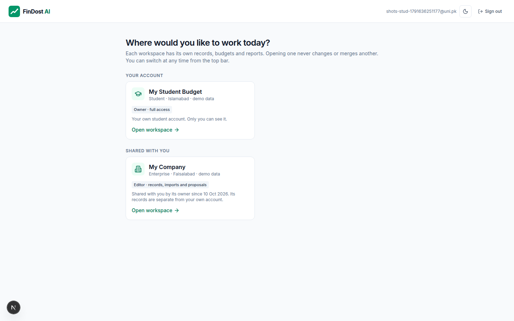
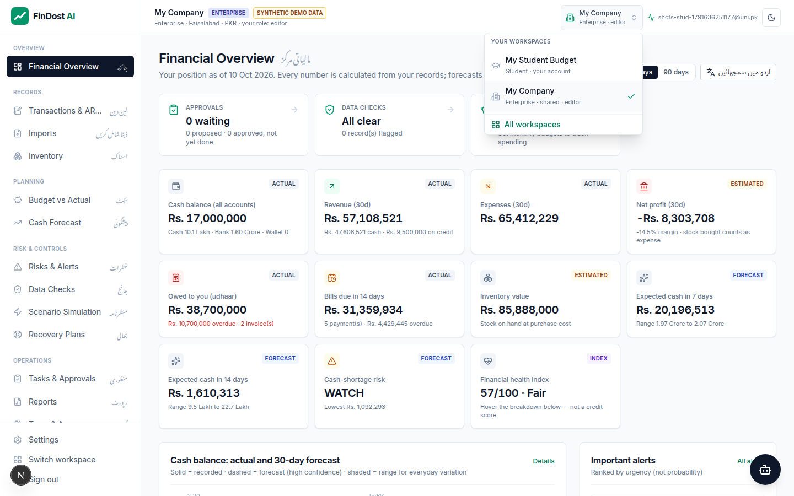
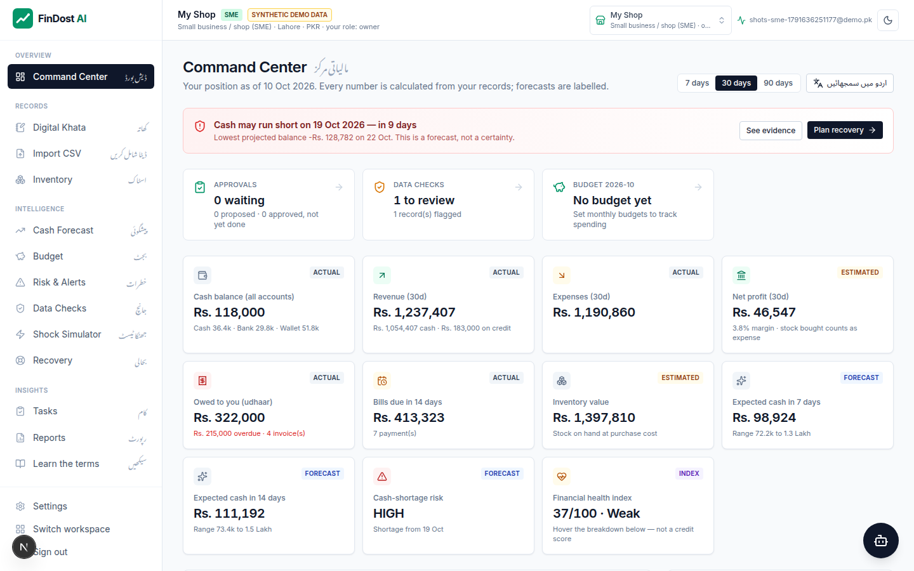
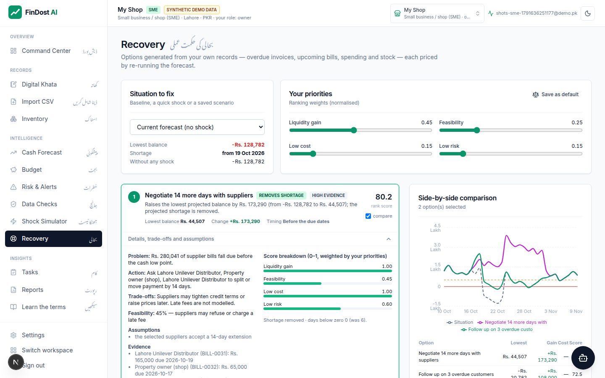
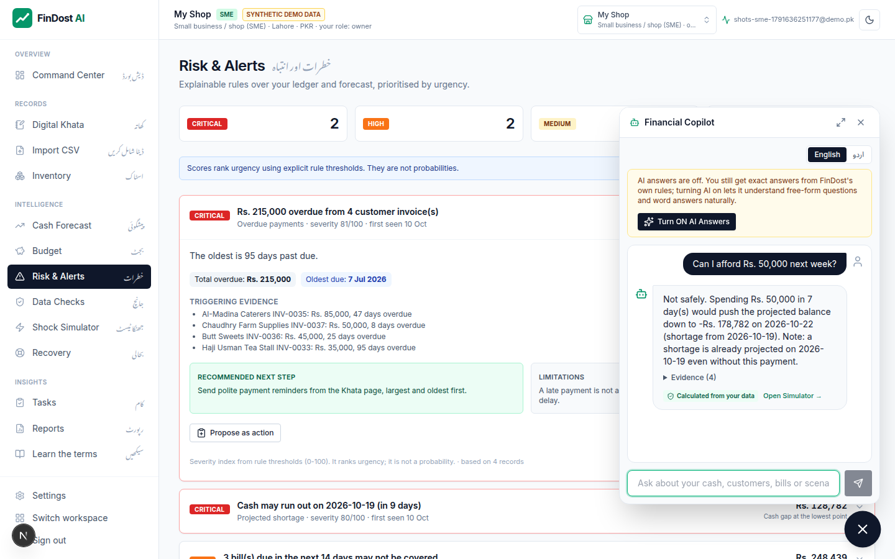
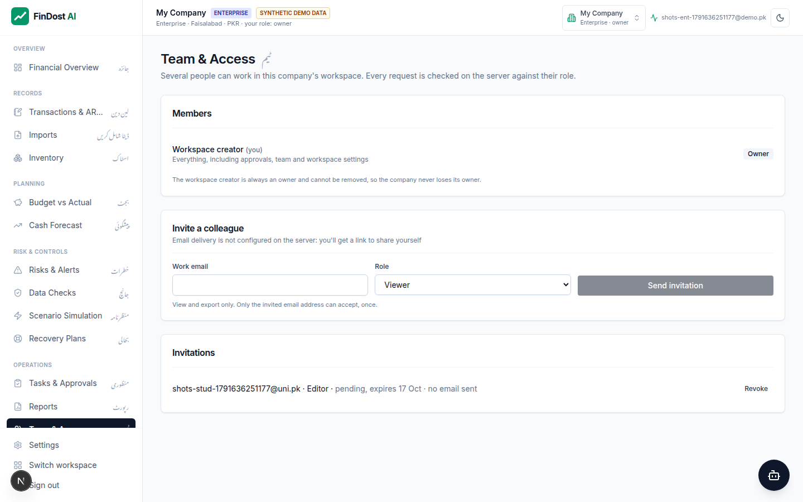

# FinDost AI

Cash-flow early warning and recovery planning for Pakistani shops, enterprises, households and students — in
English and Urdu.

**Live:** https://findostai.vercel.app · **API health:** https://findost-api.vercel.app/api/v1/health ·
**Presentation guide:** [docs/PRESENTATION_GUIDE.md](docs/PRESENTATION_GUIDE.md)

## Problem and solution

A shop can be profitable on paper and still run out of cash: customers pay late (udhaar) while rent, suppliers and
bills fall due on fixed dates. Households and students have the same timing problem with salaries, allowances and
fees. FinDost turns your records into a **30-day cash forecast**, warns you **before a projected shortage** with the
records behind it, lets you **test what-if shocks**, and **prices recovery options** by re-running the forecast.
Enterprises add budgets, data checks, an approval workflow and team roles.

Every figure is calculated by FinDost's deterministic engine from your own records. AI is optional: with your
consent it helps understand questions, words answers and reads receipt photos into proposals you review — it never
calculates your figures.

## Screenshots

Real screens from the local app with **fictional demo data**:

| Workspace selection | Switcher |
|---|---|
|  |  |
| **Shop dashboard** | **Recovery options** |
|  |  |
| **Copilot** | **Team & access** |
|  |  |

## Key features

- **Digital khata** — transactions, customers/suppliers, udhaar receivables and payables, part-payments, change history.
- **Import** — CSV with Roman Urdu headers, Pakistani amount/date formats, validation, duplicate flags, row
  corrections, one atomic commit; optional receipt reading (Gemini) into a reviewable row.
- **Forecast** — day-by-day projection from bills, age-weighted receivables, monthly patterns and everyday flows;
  model picked per workspace by back-test; range for everyday variation.
- **Early warnings** — 14 rules (shortage, reserve breach, overdue udhaar, concentration, spikes, duplicates,
  budget overrun …), each with amount at stake and linked records. Severity is urgency, not probability.
- **Shock simulator and recovery** — sales drop, late payments, price/rent/utility rises, flood, income delay;
  recovery options generated from your data, simulated and ranked by your priorities.
- **Budgets and savings goals** — budget vs actual with over-budget alerts; goal tracking for personal accounts.
- **Enterprise workflow** — data checks (not bank reconciliation), proposed actions → owner approval → completion
  with an audit trail; owner / editor / viewer roles; invitations.
- **Workspaces** — one login can open its own account plus workspaces it was invited to; you choose at each
  sign-in and switch without logging out.
- **Reports** — period report with opening → cash in/out → closing, CSV and print; figures reconcile with the
  dashboard.
- **Copilot** — floating assistant on every page; English, Urdu and Roman Urdu questions; answers from the engine.
- **Private demo** — per-visitor fictional workspace, deleted after 7 days.

## Account types

| Type | For | Distinctive modules |
|---|---|---|
| SME / shop | Kiryana, retail, micro-business | Khata, udhaar, inventory, data checks, tasks |
| Enterprise | Finance teams | Everything in SME + Team & Access; navigation grouped as a finance workflow |
| Household | Family budgets | Income & expenses, bills, budget, savings goals, personal what-ifs |
| Student | Allowance, fees, part-time income | Same as household, student wording |

The type is chosen once, when you create your own workspace; the server enforces the modules
(`backend/app/auth.py`, `FEATURES`).

## Technology

| Layer | Stack |
|---|---|
| Frontend | Next.js 15.5.27, React 19.1.1, TypeScript 5.9.2, Tailwind CSS 3.4.17, Recharts 2.15.4, Supabase JS/SSR |
| Backend | Python 3.12, FastAPI 0.143.0, Pydantic 2.14.0, SQLAlchemy 2.1.4, psycopg 3.3.6, NumPy 2.5.3, httpx, PyJWT |
| Data & auth | Supabase PostgreSQL (RLS enabled, no public policies) and Supabase Auth (email confirmation, Google, anonymous demo, Cloudflare Turnstile) |
| AI (optional) | Groq (default `openai/gpt-oss-20b`), Google Gemini (default `gemini-3.5-flash-lite`) via plain HTTPS |
| Email | Resend (auth emails through Supabase SMTP; team invitations through the Resend API) |
| Hosting | Vercel: `findost-ai` (frontend) and `findost-api` (backend + daily cron) |
| Tests | pytest, Vitest, ESLint, `tsc`, headless-Chrome scripts in `scripts/` |

## Architecture

```
Browser ─► Next.js (Vercel) ── Supabase Auth (session, captcha)
             │  /api/v1/* rewritten server-side to the API (same origin; API URL never in the bundle)
             │  Authorization: Bearer <JWT>  ·  X-Workspace-Id: <chosen workspace>
             ▼
           FastAPI (Vercel)  verify JWT ─► resolve workspace + membership + role ─► engine
             │                                                                    │
             ▼                                                                    ▼ optional, consent + quota
           PostgreSQL (Supabase)                                     Groq / Gemini (wording, receipts)
```

Diagrams, request lifecycle and the full API reference: [docs/PRESENTATION_GUIDE.md](docs/PRESENTATION_GUIDE.md)
(sections 9–13). Code: `frontend/` (App Router), `backend/app/routers` (API), `backend/app/services` (engine).

## Security model (summary)

- Supabase JWT verified on every protected request; developer tokens disabled in production.
- **Identity ≠ workspace:** a workspace id from the browser is honoured only for its owner or an active member;
  anything else returns 404. Roles: owner (all), editor (records, imports, proposals), viewer (view + export);
  read-only roles cannot change data.
- Tenant isolation is enforced in the API (every query scoped to the resolved workspace; tested). RLS blocks the
  public Supabase key; per-tenant RLS policies are on the roadmap.
- Invitations: hashed, single-use, 7-day, recipient-bound tokens; honest `email_sent` status.
- AI: opt-in per workspace, names masked, answers with unverified numbers discarded, daily quota.
- Secrets only in deployment environment variables. Details and known gaps: [docs/SECURITY.md](docs/SECURITY.md).

## Run locally

Backend (Python 3.12+; no Supabase or AI keys needed):

```bash
cd backend
python -m venv .venv && .venv/bin/pip install -r requirements-dev.txt
DATABASE_URL=sqlite:///./local.db DEV_AUTH_SECRET=local-dev-secret-change-me-0123456789 \
  .venv/bin/uvicorn app.main:app --port 8000
```

Frontend (Node 20+; developer sign-in instead of Supabase):

```bash
cd frontend
npm install
NEXT_PUBLIC_AUTH_MODE=dev DEV_AUTH_SECRET=local-dev-secret-change-me-0123456789 \
  API_URL=http://localhost:8000 npm run dev      # http://localhost:3000
```

Sign in with any email on the developer form, choose an account type, and start with demo data. To use Supabase
locally instead, fill `frontend/.env.local` from `frontend/.env.example` and leave `NEXT_PUBLIC_AUTH_MODE` empty.

## Tests

```bash
cd backend && .venv/bin/python -m pytest                        # 168 tests (mocked AI, SQLite)
cd frontend && npm run typecheck && npm run lint && npm test && npm run build   # 28 Vitest tests
# browser checks against the local stack (needs Chrome + playwright-core):
node scripts/e2e-enterprise.cjs     # enterprise workflow, roles, workspace selection/switching (26 checks)
node scripts/e2e-journey.cjs        # 10-step demo journey (15 checks)
```

Results and what is not verified: [docs/TESTING.md](docs/TESTING.md).

## Environment variables

Names only — never commit values.

**Backend** (`backend/.env.example`)

| Name | Purpose |
|---|---|
| `DATABASE_URL` | SQLite locally; Supabase transaction-pooler URL in production |
| `SUPABASE_URL` | JWKS location for verifying access tokens |
| `SUPABASE_JWT_SECRET` | Only for legacy HS256 projects |
| `DEV_AUTH_SECRET` | Local developer tokens; ignored in production |
| `CORS_ORIGINS` | Allowed origins for direct API calls |
| `GROQ_API_KEY`, `GROQ_MODEL` | Optional AI wording / question interpretation |
| `GEMINI_API_KEY`, `GEMINI_MODEL` | Optional receipt reading and AI fallback |
| `LLM_TIMEOUT_SECONDS`, `AI_DAILY_LIMIT` | AI timeout (12 s) and daily per-workspace cap (60) |
| `ANON_AI_DAILY_LIMIT`, `ANON_MAX_TRANSACTIONS`, `DEMO_TTL_DAYS` | Private-demo limits |
| `CRON_SECRET` | Authenticates the daily demo-cleanup cron |
| `RESEND_API_KEY`, `EMAIL_FROM`, `APP_URL` | Optional team-invitation emails and invitation link base |
| `FINDOST_TODAY`, `MAX_UPLOAD_BYTES`, `ENVIRONMENT` | Test date pin, upload limit, environment |

**Frontend** (`frontend/.env.example`): `API_URL`, `NEXT_PUBLIC_SUPABASE_URL`, `NEXT_PUBLIC_SUPABASE_ANON_KEY`,
`NEXT_PUBLIC_TURNSTILE_SITE_KEY`, `NEXT_PUBLIC_GOOGLE_AUTH_ENABLED`, `NEXT_PUBLIC_AUTH_MODE`,
`NEXT_PUBLIC_SITE_URL`, `DEV_AUTH_SECRET` (dev only). Supabase Auth config push also uses `TURNSTILE_SECRET_KEY`
and `RESEND_API_KEY`.

## Deployment

Two Vercel projects (`backend/`, `frontend/`) and one Supabase project. For schema changes: apply
`supabase/migrations/*` → deploy backend → deploy frontend. Rollback by promoting the previous Vercel deployment.
See [docs/DEPLOYMENT.md](docs/DEPLOYMENT.md) and [docs/ROLLBACK.md](docs/ROLLBACK.md).

## Known limitations

- Forecasts are estimates. The forecast range covers everyday variation only (43% coverage on the synthetic
  benchmark; lower when customers pay late).
- The benchmark is synthetic; FinDost has not been evaluated with real businesses.
- No bank feeds, bank reconciliation, ERP or payment integrations; FinDost never moves money.
- Approval policy is basic (owners approve). Team features are enterprise-only; no ownership transfer.
- Live AI answers and invitation email delivery are not covered by automated tests; receipt reading is not
  validated on real receipts.
- Tenant isolation is enforced in the API layer; per-tenant RLS policies are not yet added.
- Single currency (PKR). Supabase free projects pause after a week of inactivity.

## Roadmap

| Now (implemented) | Next (roadmap — not built) |
|---|---|
| Ledger, CSV/receipt import, forecast, alerts, simulator, recovery, budgets, goals, data checks, approvals, reports, Copilot, roles, workspace selection | Payment-timing uncertainty in forecasts · real-business pilot · bank feeds and reconciliation · ERP integrations · approval thresholds and chains · per-tenant RLS policies · team roles for SME · controlled execution of approved payments with human sign-off |

## Documentation

[Presentation guide](docs/PRESENTATION_GUIDE.md) · [Architecture](docs/ARCHITECTURE.md) ·
[Forecast methodology](docs/FORECAST_METHODOLOGY.md) · [Security](docs/SECURITY.md) · [Testing](docs/TESTING.md) ·
[Deployment](docs/DEPLOYMENT.md) · [Demo script](docs/DEMO_SCRIPT.md) · [Implementation report](docs/IMPLEMENTATION_REPORT.md)

FinDost AI provides decision support, not financial advice. Demo data is fictional.
