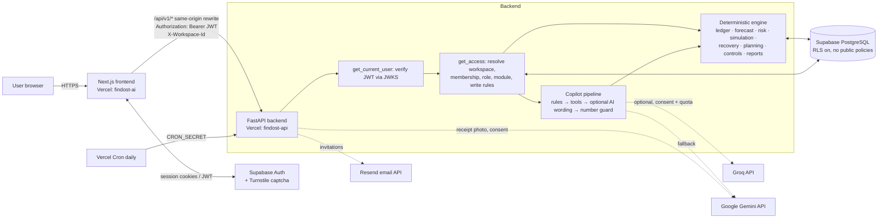
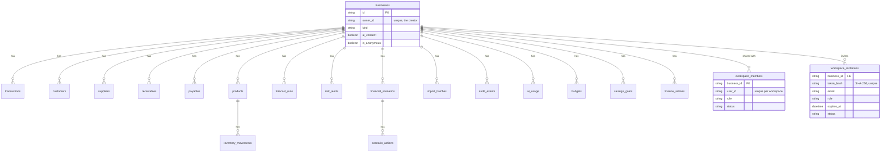
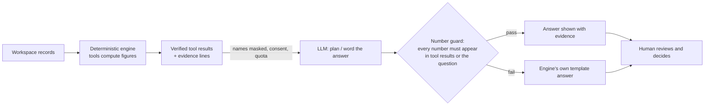
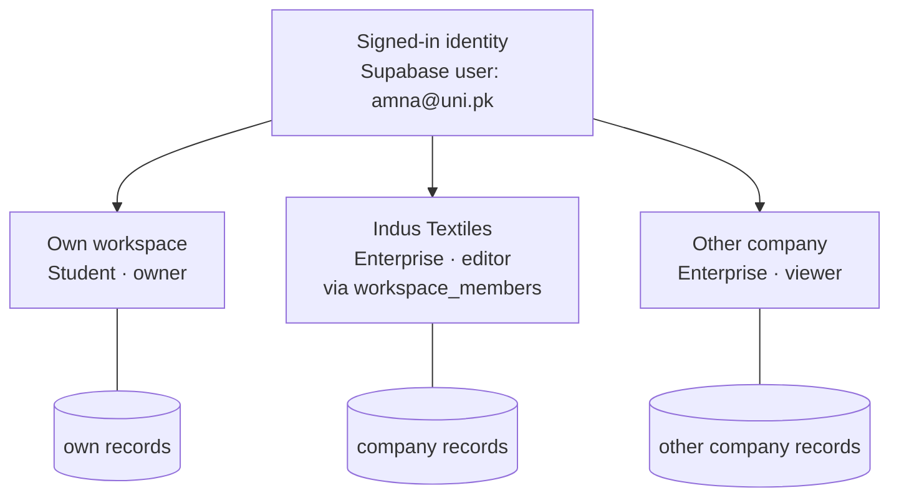
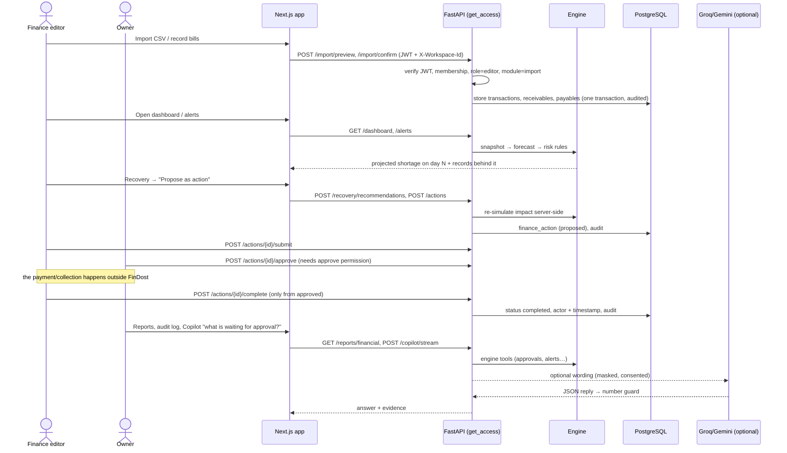

# FinDost AI — Presentation Guide

A source document for slides, judging, technical demos and product overviews. Everything here describes the code in
this repository (branch `feat/workspace-selection`, October 2026). File paths are given inline so each claim can be
traced. Status labels used throughout:

| Label | Meaning |
|---|---|
| **Implemented & tested** | In the code and covered by automated tests that ran and passed |
| **Implemented, live provider unverified** | In the code and tested with mocked providers; not verified end-to-end against the real external service by an automated test |
| **Partial** | Works, with stated gaps |
| **Roadmap** | Not built. Never presented as working |

Live site: https://findostai.vercel.app · API health: https://findost-api.vercel.app/api/v1/health

---

## 1. Executive Summary

FinDost AI is a web application that helps Pakistani shopkeepers, enterprises, households and students **see a cash
shortage before it happens and compare what they could do about it**. Users record or import their money in and
out; a deterministic engine turns those records into a 30-day cash forecast, early warnings with the records behind
them, what-if simulations and priced recovery options. Enterprises add budgets, data checks, an approval workflow
and team roles. An optional AI Copilot (Groq / Google Gemini) answers questions in English and Urdu, but **every
figure comes from the engine, never from the AI**.

What makes it credible:

* Money is integer paisa end-to-end; dashboard, reports and exports reconcile (tested, `backend/tests/test_ledger.py`).
* Every alert, forecast and recovery option exposes its assumptions and source records.
* AI is opt-in per workspace, names are masked before anything leaves the server, and an AI answer containing a
  number not present in the engine's evidence is discarded (`backend/app/services/llm.py`).
* Workspace isolation and roles are enforced on the server for every request and covered by automated tests
  (`backend/tests/test_workspaces.py`, `test_enterprise.py`).
* The forecaster is measured on a held-out **synthetic** benchmark whose limits are stated publicly
  (`backend/app/data/benchmark.json`).

What it is not (yet): it has no bank feed, no ERP integration, never moves money, and has not been evaluated with
real businesses.

## 2. Problem Statement

* Many small businesses in Pakistan run on **udhaar** (customer credit) and supplier credit, often tracked in a
  paper khata. A shop can be profitable on paper yet run out of cash, because customers pay late while rent,
  suppliers and bills fall due on fixed dates.
* Households and students face the same timing problem with salaries, allowances, fees and bills.
* Conventional tools either record the past (bookkeeping) or show charts; they rarely answer "*when* will I run
  short, *why*, and *what* would fix it, by how much?"
* Generic AI chatbots can talk about money but cannot be trusted with figures: they may invent numbers.
* Organisations need more than a chart: several people must record, review, approve and track decisions, without
  seeing another organisation's data.

## 3. Solution: FinDost AI

A financial workflow built around a deterministic engine:

```
Records (manual / CSV / receipt proposal) → validated ledger → 30-day forecast → warnings with evidence
→ what-if shocks → recovery options priced by re-running the forecast → proposed actions → approval → report
```

* **Deterministic engine** (`backend/app/services/`): ledger maths, forecast, risk rules, simulation, recovery,
  budgets, data checks. Same input → same output; covered by hand-calculated tests.
* **AI assistance, optional**: understands a question, words an answer, reads a receipt photo into a proposal the
  user must review. It cannot introduce figures.
* **Collaboration** (enterprise): owner / editor / viewer roles, invitations, approvals and an audit log.
* **Multi-workspace identity**: one login can open its own account plus workspaces it was invited to, choosing
  explicitly at each sign-in (section 17).

## 4. Target Users and Account Types

The account type is chosen once, when the user creates their own workspace, and cannot be switched
(`POST /api/v1/onboarding` returns 409 `already_onboarded`). It decides the modules, enforced on the server by
`FEATURES` in `backend/app/auth.py` (requests to other modules → 403 `feature_unavailable`) and mirrored in the
navigation (`frontend/components/app/nav-config.ts`).

| Module (server feature) | SME / shop | Enterprise | Household | Student |
|---|:-:|:-:|:-:|:-:|
| Ledger (transactions, customers, suppliers, audit) | ✓ | ✓ | ✓ | ✓ |
| Receivables (udhaar) | ✓ | ✓ | – | – |
| Payables / bills | ✓ | ✓ | ✓ | ✓ |
| Inventory | ✓ | ✓ | – | – |
| Import (CSV, receipt) | ✓ | ✓ | ✓ | ✓ |
| Forecast, alerts, simulator, recovery, reports, copilot | ✓ | ✓ | ✓ | ✓ |
| Budget vs actual | ✓ | ✓ | ✓ | ✓ |
| Data checks (controls), Tasks & approvals (actions) | ✓ | ✓ | – | – |
| Savings goals | – | – | ✓ | ✓ |
| Team & access (members, invitations) | – | ✓ | – | – |

* **SME / shopkeeper** — kiryana, retail, micro-business: "Digital Khata", udhaar, stock, shop-specific shocks
  ("Supplier prices +15%").
* **Enterprise** — finance teams: navigation grouped as Overview → Records → Planning → Risk & controls →
  Operations (Tasks & Approvals, Reports, Team & Access).
* **Household / Student** — personal-finance wording from `frontend/lib/terms.ts` ("My Money", "Income &
  Expenses", "Spending Adjustment Plan"), personal what-if presets (`PERSONAL_PRESETS` in
  `backend/app/services/simulation.py`: salary/allowance 10 days late, income −20%), recovery options reworded
  (`PERSONAL_WORDING` in `backend/app/services/recovery.py`). No inventory, supplier or shop terms (tested in
  `frontend/components/app/nav-config.test.ts`).

## 5. Product Features

Format per feature: **what** · **who** · **input** · **frontend** · **backend** · **how** · **AI?** · **output** ·
**limits**. Status in brackets.

### 5.1 Authentication, registration and account types [Implemented & tested; Google sign-in config-dependent]
* **What/who:** email + password sign-up with email confirmation, password reset, optional Google OAuth, and a
  captcha-protected anonymous **private demo**.
* **Frontend:** `app/login`, `app/signup`, `app/forgot-password`, `app/reset-password`, `app/auth/callback`,
  `app/auth/confirm`, `components/auth/*`; session cookies refreshed in `frontend/middleware.ts`.
* **Backend:** `get_current_user` in `backend/app/auth.py` verifies the Supabase JWT (ES256 via JWKS, audience
  `authenticated`; legacy HS256 secret optional). Developer tokens (`DEV_AUTH_SECRET`) are ignored when
  `ENVIRONMENT=production` (tested).
* **How:** Supabase Auth issues the session; Cloudflare Turnstile is verified by Supabase on sign-up/sign-in/demo.
  `POST /onboarding` creates the user's own workspace with the chosen type (optionally with fictional demo data).
* **AI:** no. **Limits:** Google button hidden unless `NEXT_PUBLIC_GOOGLE_AUTH_ENABLED=true`.

### 5.2 Workspace selection and switching [Implemented & tested]
* **What/who:** every user; essential for anyone invited to another organisation.
* **Frontend:** `app/workspaces/page.tsx` ("Where would you like to work today?"),
  `components/app/workspace-switcher.tsx` (top bar), `lib/workspace.ts` (session-bound choice),
  `components/app/app-provider.tsx` (gate).
* **Backend:** `GET /api/v1/me` lists every workspace the user may open (`memberships()` and
  `resolve_access()` in `backend/app/auth.py`); `X-Workspace-Id` header honoured only for owners/active members.
* **Details:** section 17.

### 5.3 Enterprise membership, invitations and roles [Implemented & tested; email delivery live-unverified]
* **Frontend:** `app/(app)/team/page.tsx`, `app/invite/page.tsx`.
* **Backend:** `backend/app/routers/team.py`; models `WorkspaceMember`, `WorkspaceInvitation`
  (`backend/app/models.py`).
* **How:** the owner invites an email with a role; a 32-byte random token is created, only its SHA-256 hash is
  stored, valid 7 days, single use, revocable. Accepting requires a signed-in, non-anonymous user whose email
  matches (case-insensitive). If `RESEND_API_KEY` is set the invitation is emailed via the Resend API; otherwise —
  or if delivery fails — the API returns `email_sent: false` and the owner gets the link to share.
* **Roles** (`PERMISSIONS` in `backend/app/auth.py`): owner = read, export, write, propose, approve, admin;
  editor = read, export, write, propose; viewer = read, export.
* **Limits:** no ownership transfer (the creator is the permanent owner); team module is enterprise-only.

### 5.4 Transaction ledger (Digital Khata) [Implemented & tested]
* **Input:** income, expense, credit sale, credit purchase, transfers; customers and suppliers.
* **Frontend:** `app/(app)/transactions/page.tsx`, `components/khata/*`.
* **Backend:** `backend/app/routers/ledger.py`, `backend/app/services/ledger.py`.
* **How:** amounts stored as integer paisa; a credit sale creates a receivable and moves no cash until paid;
  part-payments cannot exceed the outstanding amount (422 `overpayment`); every create/edit/delete is written to
  `audit_events`. **Output:** balances by account (cash/bank/wallet), CSV export. **AI:** no.

### 5.5 CSV import and confirmation [Implemented & tested]
* **Frontend:** `app/(app)/import/page.tsx`. **Backend:** `backend/app/routers/imports.py`,
  `backend/app/services/ingestion.py`.
* **How:** `POST /import/preview` parses the file (≤ 2 MB), infers column mapping (including Roman Urdu headers such
  as `Tarikh`, `Raqam`), day-first vs month-first dates (ISO dates never swapped), Pakistani number formats
  ("Rs. 1,25,000", "(5,000)"), suggests categories, flags likely duplicates and invalid rows. Rows can be corrected
  (`PUT /import/batches/{id}/rows/{n}`). `POST /import/confirm` writes everything in one transaction; duplicates are
  skipped unless explicitly confirmed; payments are matched to open invoices without over-settling.
* **AI:** no. **Limits:** CSV only; bank-statement PDFs not supported.

### 5.6 Receipt reading [Implemented, live provider unverified]
* **Frontend:** import page, receipt card. **Backend:** `POST /import/receipt` → `extract_receipt` in
  `backend/app/services/ai/tasks.py` (Gemini only).
* **How:** requires a non-demo account and AI consent; JPG/PNG/WEBP/PDF ≤ 4 MB with magic-byte check. Gemini returns
  strict JSON (merchant, date, total, line items, confidence); amounts parsed with `Decimal`; confidence below 0.6,
  odd dates or non-PKR amounts are flagged and must be corrected. The result is a **proposal row in an import
  batch** — nothing is written to the ledger until the user confirms the import.
* **Limits:** not validated on a set of real Pakistani receipts; one document at a time.

### 5.7 Income and expense analysis [Implemented & tested]
* Dashboard KPIs (`GET /dashboard`, `backend/app/services/insights.py`): cash by account, revenue (cash vs
  credit), expenses, net profit (30 days), receivables/payables with overdue amounts, expected cash in 7/14 days with
  a range, shortage risk, a **financial health index** (FinDost's own 0–100 score: liquidity 25, forecast safety 25,
  profit margin or savings rate 20, receivables quality 15, cash-flow stability 15 — not a credit score) and a
  data-quality score.

### 5.8 Receivables and payables [Implemented & tested]
* `GET/POST/PUT /receivables`, `/payables`, payments sub-routes; WhatsApp reminder text
  (`GET /receivables/{id}/reminder`) opens a pre-filled `wa.me` link — nothing is sent automatically.

### 5.9 Cash-flow forecasting [Implemented & tested]
* `GET /forecast`, `backend/app/services/forecast.py`; methodology in section 16 and
  `docs/FORECAST_METHODOLOGY.md`.

### 5.10 Risk alerts and shortage detection [Implemented & tested]
* `GET /alerts`, `backend/app/services/risk.py`. 14 rules: projected shortage, reserve breach (now / projected),
  obligations at risk, revenue decline, bill increase, expense spike, overdue receivables, credit exposure, customer
  concentration, supplier concentration, unusual transaction / possible duplicate, slow inventory, insufficient
  history, budget overrun. Each alert carries a severity (urgency, **not probability**), the amount at stake, an
  explanation, next steps and links to the exact records.

### 5.11 Scenario simulation [Implemented & tested]
* `app/(app)/simulator/page.tsx`; `/scenarios/*`, `backend/app/services/simulation.py`.
* Shocks: sales decline, delayed payment, supplier price increase, unexpected expense, utility/rent increase,
  business interruption, flood, customer loss; personal: income delay, income change. What-ifs and saved scenarios.
  Each edits a copy of the forecast inputs and re-runs the same projection; **the ledger is never modified**
  (tested).

### 5.12 Recovery recommendations [Implemented & tested]
* `app/(app)/recovery/page.tsx`; `POST /recovery/recommendations`, `backend/app/services/recovery.py`.
* Candidates generated from the user's own records: follow up on overdue customers, request partial early payment,
  negotiate 14 more days with suppliers, buy 30% less non-essential stock for 2 weeks, clearance sale of slow stock,
  cut discretionary spending. Each is simulated; ranked by user-adjustable weights (default liquidity 0.45,
  feasibility 0.25, cost 0.15, risk 0.15); a combined plan adds the best options until the shortage disappears.
  Deferred bills that would fall after the forecast window stay counted as owed (not shown as savings; tested).
* **Output:** lowest projected balance change, timing, cost, assumptions, trade-offs; "rank score" is a ranking,
  not a probability of success. **AI:** no.

### 5.13 Budgets and budget vs actual [Implemented & tested]
* `app/(app)/budget/page.tsx`; `GET/PUT /budgets`, `DELETE /budgets/{id}`; `budget_vs_actual` in
  `backend/app/services/planning.py`. Monthly amount per category compared with expenses recorded this month;
  status ok / near (≥ 90%) / over; an over-budget alert; budget section in reports.

### 5.14 Savings goals [Implemented & tested]
* Household/student. `app/(app)/goals/page.tsx`; `/goals`; `goal_view` in `planning.py`: remaining amount, monthly
  amount needed, compared with average monthly net over the last 90 days → on track / at risk / reached / overdue.
* **Limit:** "saved so far" is entered by the user, not tracked from accounts.

### 5.15 Financial data-quality checks [Implemented & tested]
* `app/(app)/controls/page.tsx`; `GET /controls`; `run_checks` in `backend/app/services/controls.py`. Read-only
  checks: possible duplicates, uncategorized, future-dated, over-settled invoices/bills, invoice vs sale mismatch,
  payments not linked to an invoice/bill, unusual amounts, cash totals consistency.
* **Limit:** this is internal consistency checking, **not bank reconciliation** (no bank feed).

### 5.16 Proposed actions, approvals, completion, audit [Implemented & tested]
* `app/(app)/actions/page.tsx`, `components/app/propose-action.tsx` (from recovery options, alerts, data checks);
  `/actions`, `POST /actions/{id}/{verb}` in `backend/app/routers/workflow.py`.
* States: proposed → pending_approval → approved / rejected → completed; cancel. Submit/complete need `propose`;
  approve/reject need `approve` (owners). The estimated impact is **re-simulated on the server** (client values are
  ignored). Every transition is row-locked and audited (actor and timestamp).
* **Limits:** one approval rule (owners approve); no amount thresholds or segregation rules; FinDost never executes
  payments — "completed" is what a person recorded.

### 5.17 Reports and exports [Implemented & tested]
* `app/(app)/reports/page.tsx`; `GET /reports/financial` (+ `.csv`), `GET /transactions/export.csv`. Period
  opening → cash in/out → closing, revenue/expenses/profit, risks, scenarios, recovery options, budget, actions,
  data checks, limitations. CSV cells are neutralised against spreadsheet formula injection.

### 5.18 AI Copilot [Implemented & tested with mocks; live answers unverified by automated tests]
* Floating panel on every app page (`components/copilot/floating.tsx`, `chat.tsx`) and `/copilot`. Section 14.

### 5.19 Languages [Partial]
* English UI; Urdu labels, Urdu-script answers and summaries from templates (`backend/app/services/i18n.py`,
  copilot `lang="ur"`); Roman Urdu questions are understood by the rules; Roman Urdu *wording* of answers needs AI
  consent (Groq/Gemini).

### 5.20 Public benchmark and SDG section [Implemented & tested]
* Landing page `#impact` (`components/landing/landing.tsx`) fed by `GET /api/v1/public/benchmark`. Synthetic
  held-out benchmark, SDG targets 1.4, 1.5, 8.3, 9.3, 10.2 with explicit "hypothetical, not measured" pathway.
  The old in-app `/impact` page redirects to the landing section; `GET /api/v1/impact` is retired (403 for every type).

### 5.21 Demo mode [Implemented & tested]
* "Try a private demo": anonymous Supabase user + fictional dataset per visitor (`backend/app/services/seed.py`),
  re-anchored to today; 3,000-transaction cap, 10 AI calls/day, no receipt reading, deleted after 7 days by a
  daily Vercel Cron (`GET /api/v1/internal/cleanup-demos`, requires `CRON_SECRET`).

### 5.22 Settings, AI consent and quotas [Implemented & tested]
* `app/(app)/settings/page.tsx`; `/business`, `/account/settings`, `/ai/status`, `/ai/test`. AI consent is
  per workspace, off by default, owner-only. Daily AI quota per workspace stored in `ai_usage` (default 60/day,
  10 for private demos). "Test AI connection" sends one fixed fictional sentence.

## 6. Enterprise Finance Workflow

| # | Stage | Who | Automated by FinDost | Needs a person |
|---|---|---|---|---|
| 1 | Collect & import data | editor/owner | parsing, mapping, date/amount normalisation | upload, correct, confirm |
| 2 | Validate & find data problems | — | import validation; data checks | fix flagged records |
| 3 | Categorise | — | category suggestions (rules + user history) | accept/override |
| 4 | Financial position & obligations | — | ledger balances, receivables, payables | — |
| 5 | Forecast | — | 30-day projection, model choice, range | — |
| 6 | Shortage / overspending detection | — | 14 alert rules, budget overruns | acknowledge |
| 7 | Explain the risk | — | evidence records, contributors; Copilot | read |
| 8 | Simulate interventions | — | re-projection per scenario | choose scenarios |
| 9 | Propose actions | editor/owner | recovery options priced by simulation | click "Propose as action" |
| 10 | Approval | owner | state machine, permission checks | approve / reject |
| 11 | Record completion | editor/owner | audit entry with actor/time | mark completed after doing it outside FinDost |
| 12 | Reports & audit | anyone with access | report, CSV, audit log | export |
| 13 | Collaborate | owner | membership checks on every request | invite, set roles |
| 14 | Ask the Copilot | anyone with access | engine tools + optional AI wording | ask |

**Roadmap (not built):** bank feeds and bank reconciliation, ERP/accounting integrations, multi-entity
consolidation, amount-based and multi-level approval policies, scheduled reports, and controlled execution of
approved operations through payment providers. Consequential decisions stay with authorised people.

## 7. User Journey

1. Visitor reads the landing page (features, synthetic benchmark, SDG section) → **Get started** or **Try a private demo**.
2. Sign-up with email confirmation (or demo / Google) → **onboarding**: choose account type, optional demo data.
3. Each new sign-in → **workspace selection screen** → open a workspace.
4. Dashboard: cash, forecast chart, alerts, health index, workflow tiles (enterprise).
5. Record / import → forecast and alerts update → simulate → recovery → propose action → approval → report.
6. Ask the floating Copilot at any point; switch workspace from the top bar without signing out.

## 8. Technology Stack

Versions are the exact pins in `frontend/package.json` and `backend/requirements*.txt`.

| Layer | Technology (version) | Role | Boundary |
|---|---|---|---|
| Frontend framework | Next.js **15.5.27** (App Router), React **19.1.1**, TypeScript **5.9.2** | Pages, routing, server-side proxy `/api/v1/*` → API | No financial calculations in the browser |
| Styling / UI | Tailwind CSS **3.4.17**, lucide-react **0.544.0**, framer-motion **14.1.0** (landing animations) | Design system, icons | — |
| Charts | Recharts **2.15.4** | Balance/forecast charts | Displays server data only |
| Auth client | @supabase/supabase-js **2.117.3**, @supabase/ssr **0.12.7** | Session, cookies, middleware refresh | Tokens verified again by the API |
| State / data | React context (`app-provider.tsx`) + `useApi` hook (`lib/hooks.ts`); no external state library | Per-page fetching with abort | — |
| Backend | Python **3.12** (`backend/.python-version`), FastAPI **0.143.0**, Pydantic **2.14.0**, Uvicorn **0.54.0** | REST API, validation (`extra="forbid"`) | — |
| ORM / DB driver | SQLAlchemy **2.1.4**, psycopg[binary] **3.3.6** | Models, queries, row locks | SQLite for local/tests |
| Numerics | NumPy **2.5.3** | Forecast arrays | — |
| HTTP / auth libs | httpx **0.28.1** (AI + email APIs), PyJWT[crypto] **2.15.1**, python-multipart **0.0.32** | Provider calls, JWT verification, uploads | No vendor SDKs |
| Database | Supabase PostgreSQL (transaction pooler) | All data; RLS enabled on every table | See section 18 on RLS |
| Auth service | Supabase Auth | Email/password, confirmation, reset, Google, anonymous demo | — |
| AI | Groq (default model `openai/gpt-oss-20b`), Google Gemini (default `gemini-3.5-flash-lite`) — defaults in `backend/app/config.py`, overridable by `GROQ_MODEL`/`GEMINI_MODEL` | Question interpretation, wording, receipt reading | Optional; never computes figures |
| Email | Resend (Supabase Auth SMTP for auth emails; REST API for team invitations) | Confirmation, reset, invitations | Invitations report `email_sent` honestly |
| Abuse protection | Cloudflare Turnstile (verified by Supabase Auth) | Captcha on sign-up/sign-in/demo | — |
| Hosting | Vercel: `findost-ai` (Next.js) and `findost-api` (FastAPI, `backend/vercel.json` with a daily cron) | Serverless deploys | — |
| Testing | pytest **9.1.1**, Vitest **3.2.6**, ESLint **9.39.4** (+ eslint-config-next), `tsc`, Playwright-core driven Chrome scripts in `scripts/` | Unit, API, browser | Node version not pinned in `package.json` (developed on Node 22) |

## 9. System Architecture



* **Synchronous:** every API request (including simulations, recovery and Copilot) is computed during the request.
  The Copilot stream (`POST /copilot/stream`) sends progress events over SSE while the same request runs.
* **Asynchronous:** only the daily Vercel Cron that deletes expired private demos. No queues or background workers.
* **Validation:** Pydantic schemas (`backend/app/schemas.py`, unknown fields rejected), upload checks in
  `routers/imports.py`, model output schemas in `services/ai/tasks.py`.
* **Authorization:** `get_current_user` → `get_access` → `require_feature` / `require_permission`
  (`backend/app/auth.py`), plus explicit checks in `workflow.py` and `team.py`.
* **Errors:** a uniform JSON envelope `{"error": {"code", "message", "details"}}`; unhandled errors return
  `internal_error` with a request id, logging only exception type and code location
  (`backend/app/errors.py`). AI failures fall back to the next provider, then to FinDost's own template answer.

## 10. Frontend Architecture

* `frontend/app/` — App Router. Public: `/` (landing), `/login`, `/signup`, `/forgot-password`, `/reset-password`,
  `/auth/*`. Authenticated without a workspace: `/onboarding`, `/workspaces`, `/invite`. Workspace pages under
  `app/(app)/`: dashboard, transactions, import, forecast, alerts, simulator, recovery, inventory, budget, goals,
  controls, actions, reports, team, copilot, learn (glossary), settings; `/impact` redirects to `/#impact`.
* `frontend/middleware.ts` — refreshes the Supabase session and redirects signed-out users from app paths to
  `/login?next=…` (query string preserved, e.g. invitation tokens).
* `components/app/app-provider.tsx` — loads `/me`, enforces "choose a workspace this session", exposes
  `business`, `role`, `has(feature)`, `can(permission)`, `switchWorkspace`.
* `components/app/shell.tsx` — sidebar from `nav-config.ts` (per account type), top bar with
  `WorkspaceSwitcher`, view-only notice, `ModuleGuard` (friendly "not part of your account type" page), floating
  Copilot.
* `lib/api.ts` — `api()` adds `Authorization` and `X-Workspace-Id`, parses the error envelope into `ApiError`,
  dispatches `findost:unauthorized` (→ login), `findost:onboarding`, `findost:workspace_lost` (→ selector).
  `lib/copilot-stream.ts` reads the SSE stream. The API base URL is not exposed: `next.config.ts` rewrites
  `/api/v1/*` to `API_URL` on the server.

## 11. Backend Architecture

* `backend/app/main.py` — FastAPI app, CORS, error handlers, routers under `/api/v1`, `/api/v1/health`.
* `backend/app/routers/` — `account`, `ledger`, `analytics` (dashboard, forecast, alerts, reports, copilot,
  benchmark), `scenarios` (simulation, recovery), `inventory`, `imports`, `planning` (budgets, goals), `workflow`
  (controls, actions), `team`, `internal` (cron).
* `backend/app/services/` — the engine: `ledger.py`, `snapshot.py` (one consistent in-memory view of a workspace's
  records per request), `forecast.py`, `risk.py`, `simulation.py`, `recovery.py`, `planning.py`, `controls.py`,
  `insights.py`, `inventory.py`, `ingestion.py`, `categories.py`, `copilot.py`, `copilot_nlu.py`, `i18n.py`,
  `impact.py`, `audit.py`, `seed.py`, `ai/` (providers, tasks, agent).
* Request lifecycle: JWT verified → workspace resolved and checked → module and write rules → router loads a
  `Snapshot` for that workspace → engine computes → response; writes go through SQLAlchemy in one transaction and
  are audited.

## 12. Database and Data Model

Schema: `backend/app/models.py`; SQL migrations in `supabase/migrations/` (generated by
`backend/scripts/export_schema.py`, all additive):
`20261010000000_findost_schema.sql`, `20261011000000_audit_and_ai_usage.sql`, `20261012000000_private_demo_flag.sql`,
`20261013000000_enterprise_workspaces.sql`. No migration was needed for workspace selection.



* A **workspace** is a `businesses` row. `owner_id` (unique) is the Supabase user who created it — one own
  workspace per user. Other users reach it only through an **active** `workspace_members` row.
* Every financial table has `business_id` with `ON DELETE CASCADE`; every query filters by it.
* Money: `BIGINT` paisa. Timestamps with time zone. Check constraints on statuses, roles and positive amounts.

## 13. API Architecture and Endpoint Reference

* Base path `/api/v1`. Browser → Next.js server rewrite → API (same origin). JSON bodies validated by Pydantic.
* **Auth column:** *public* = no token; *user* = valid JWT, no workspace needed; *workspace* = valid JWT + workspace
  resolved by `get_access` (own workspace by default, or `X-Workspace-Id` if the user owns it or is an active
  member — otherwise **404 `workspace_not_found`**). For *workspace* routes: viewers are refused on any non-GET
  request except calculation-only POSTs (simulate, compare, recovery, copilot, AI test) → 403 `read_only_role`.
* **Module:** the account-type feature required (403 `feature_unavailable` otherwise).
* **AI:** whether the route can call an external AI provider.
* OpenAPI: FastAPI serves `/docs` and `/openapi.json` on the API host (`https://findost-api.vercel.app/docs`); the
  internal cron route is not listed there.

### Account and workspaces
| Method | Path | Purpose | Auth | Role / module | AI |
|---|---|---|---|---|---|
| GET | `/me` | Identity, open workspace, role, permissions, all accessible workspaces, `workspace_denied` | user | — | no |
| POST | `/onboarding` | Create the user's own workspace (type fixed) | user | once per user | no |
| GET / PUT | `/business` | Workspace profile | workspace | PUT: admin | no |
| GET / PUT | `/account/settings` | Language, reserve, opening balances, AI consent | workspace | PUT: admin | no |
| POST | `/business/reset-demo`, `/business/clear` | Reload demo data / delete all records | workspace | admin | no |
| GET | `/glossary` | Finance terms (EN/UR) | public | — | no |

### Ledger, receivables, payables, audit
| Method | Path | Purpose | Auth | Module | AI |
|---|---|---|---|---|---|
| GET / POST | `/transactions` | List (filters, paging) / create | workspace | ledger | no |
| GET / PUT / DELETE | `/transactions/{tx_id}` | Read / edit / delete (audited) | workspace | ledger | no |
| GET | `/transactions/categories` | Category list | workspace | — | no |
| GET | `/transactions/export.csv` | CSV export of the open workspace | workspace | ledger | no |
| GET / POST | `/customers`, `/suppliers` | Parties | workspace | ledger | no |
| GET / POST | `/receivables`; PUT `/receivables/{id}`; POST `/receivables/{id}/payments`; GET `/receivables/{id}/reminder` | Udhaar invoices, payments, reminder text | workspace | receivables | no |
| GET / POST | `/payables`; PUT / DELETE `/payables/{id}`; POST `/payables/{id}/payments` | Bills and payments | workspace | payables | no |
| GET | `/audit` | Change history | workspace | ledger | no |

### Imports
| Method | Path | Purpose | Auth | Module | AI |
|---|---|---|---|---|---|
| GET | `/import/templates/{name}` | Sample CSVs | public | — | no |
| POST | `/import/preview` | Parse + validate a CSV into a batch | workspace | import | no |
| POST | `/import/receipt` | Read a receipt into a proposal (consent, non-demo) | workspace | import | **Gemini** |
| PUT | `/import/batches/{batch_id}/rows/{row_number}` | Correct a row | workspace | import | no |
| POST | `/import/confirm` | Commit the batch atomically | workspace | import | no |
| GET | `/import/batches` | Import history | workspace | import | no |

### Analytics, forecasting, risk
| Method | Path | Purpose | Auth | Module | AI |
|---|---|---|---|---|---|
| GET | `/dashboard` | KPIs, forecast summary, alerts, breakdowns, health index | workspace | — | no |
| GET | `/forecast` | Daily projection, model/back-test, contributors, assumptions | workspace | forecast | no |
| GET | `/alerts`; POST `/alerts/{id}/acknowledge` | Early warnings with evidence | workspace | alerts | no |

### Scenarios and recovery
| Method | Path | Purpose | Auth | Module | AI |
|---|---|---|---|---|---|
| GET | `/scenarios/presets` | Presets per account type | workspace | simulator | no |
| POST | `/scenarios/simulate` | Ad-hoc simulation (viewers allowed) | workspace | simulator | no |
| GET / POST | `/scenarios`; GET / PUT / DELETE `/scenarios/{id}`; POST `/scenarios/{id}/simulate`; POST `/scenarios/compare` | Saved scenarios | workspace | simulator | no |
| POST | `/recovery/recommendations`, `/recovery/compare` | Generated, simulated, ranked options | workspace | recovery | no |

### Budgets, goals, data checks, actions
| Method | Path | Purpose | Auth | Role / module | AI |
|---|---|---|---|---|---|
| GET / PUT | `/budgets`; DELETE `/budgets/{id}` | Monthly category budgets + budget vs actual | workspace | budget; write for changes | no |
| GET / POST | `/goals`; PUT / DELETE `/goals/{id}` | Savings goals | workspace | goals | no |
| GET | `/controls` | Read-only data checks | workspace | controls | no |
| GET / POST | `/actions` | List / propose (impact re-simulated on server) | workspace | actions; POST needs propose | no |
| POST | `/actions/{id}/{verb}` | `submit`, `approve`, `reject`, `complete`, `cancel` | workspace | actions; approve/reject need approve | no |

### Team and invitations
| Method | Path | Purpose | Auth | Role / module | AI |
|---|---|---|---|---|---|
| GET | `/team` | Members, pending invitations, whether email delivery is configured | workspace | team | no |
| POST | `/team/invitations` | Invite email + role; returns link and `email_sent` | workspace | team + admin | no (email via Resend) |
| DELETE | `/team/invitations/{id}` | Revoke | workspace | team + admin | no |
| PUT | `/team/members/{user_id}` | Change role (creator protected) | workspace | team + admin | no |
| DELETE | `/team/members/{user_id}` | Remove member, or leave (self) | workspace | team; admin unless self | no |
| GET | `/invitations/{token}` | Preview an invitation | user | — | no |
| POST | `/invitations/accept` | Join (email must match, single use) | user | — | no |

### Copilot, AI, reports, public, internal
| Method | Path | Purpose | Auth | Module | AI |
|---|---|---|---|---|---|
| POST | `/copilot/query` | Answer a question (JSON) | workspace | copilot | **optional** (consent) |
| POST | `/copilot/stream` | Same, with SSE progress events | workspace | copilot | **optional** |
| GET | `/ai/status` | Consent, providers configured (booleans), quota | workspace | — | no |
| POST | `/ai/test` | Fixed fictional sentence through the provider | workspace | — | **yes** |
| GET | `/reports/financial`, `/reports/financial.csv` | Period report / CSV | workspace | reports | no |
| GET | `/public/benchmark` | Synthetic benchmark, definitions, limitations, SDG targets | public | — | no |
| GET | `/impact` | Retired (no account type has the module) | workspace | impact → 403 | no |
| GET | `/health` | Status + which AI providers are configured (booleans) | public | — | no |
| GET | `/internal/cleanup-demos` | Delete expired anonymous demo workspaces | `Authorization: Bearer CRON_SECRET` | — | no |

## 14. AI Integration and Copilot

### A. Principle


### B. Copilot pipeline (`_copilot_steps` in `backend/app/routers/analytics.py`)
1. **Auth & scope:** the request goes through `get_access`; tools read only the open workspace's `Snapshot`.
2. **Rules first, no AI:** `copilot_nlu.py` scores intents from English, Roman Urdu and Urdu concepts and extracts
   parameters (amount, days, percent, party); follow-ups reuse the previous intent. Greetings get a short reply.
3. **Engine tools** (`TOOLS` in `backend/app/services/copilot.py`, docs in `TOOL_DOCS` in `services/ai/agent.py`):
   balance, why_risk, overdue, upcoming_expense, after_suppliers, follow_up, party, compare, spending,
   expense_compare, performance, explain_dashboard, affordability, sales_decline, delayed_collection, scenario,
   glossary, inventory, alerts, plus database-backed budget, approvals, data_checks, goals. Tools respect the
   account type's modules.
4. **Only with AI consent and quota:** if the rules cannot place the question, the model maps it to one tool
   (`interpret`); if still unplaced, the **agent** plans which tools to run (strict JSON), the engine runs them, and
   the model composes the wording. Customer/supplier names are masked (`[P1]`) before sending; the model never sees
   raw ledger rows.
5. **Guard:** any number not present in the tool results (or the user's message) → the reply is discarded and the
   engine's wording is used.
6. **Providers:** Groq first (default `openai/gpt-oss-20b`, strict JSON schema), Gemini as fallback; one capped
   retry; 12 s timeout (`LLM_TIMEOUT_SECONDS`). Unavailable/failed/over-quota → FinDost's own answer, labelled
   "Calculated from your data".
7. **Display:** the answer, its evidence and links to the related pages; streamed stages ("Reading your
   records…") via `POST /copilot/stream`.

### C. Receipt extraction — see 5.6. Gemini only; result is a reviewable proposal; never auto-committed.

### D. Limits
* Hallucination risk is contained for **numbers** (guard), not eliminated for wording or interpretation (a model
  can still pick a less relevant tool).
* Dependent on external free tiers (rate limits, availability); AI is never required for the core product.
* Privacy: with consent, masked question text and computed results go to Groq/Google; receipt images go to Google.
* No model training or fine-tuning exists in this repository. No autonomous payments. Not financial advice.
* Live behaviour: providers are configured in production (health endpoint booleans) and the owner reported a
  working "Test AI connection"; automated tests use mocked HTTP only.

## 15. Deterministic Financial Engine

| Calculation | Where | Notes |
|---|---|---|
| Balances by account; revenue (cash vs credit), expenses, profit | `services/ledger.py` (`account_balances`, `period_summary`) | Integer paisa; credit sales are revenue, not cash |
| Receivables / payables outstanding, overdue | `services/ledger.py`, `snapshot.py` | Payments never exceed outstanding |
| 30-day projection, contributors, runway | `services/forecast.py` | Section 16 |
| Scenario outcomes | `services/simulation.py` | Copy of forecast inputs; ledger untouched |
| Recovery impact | `services/recovery.py` | Each option = one simulation; deferred bills stay owed |
| Budget variance, goal monthly need | `services/planning.py` | Actual = expenses recorded in the month |
| Risk signals | `services/risk.py` | 14 rules with evidence |
| Health index, data quality | `services/insights.py` | FinDost-defined scores, explained |
| Data checks | `services/controls.py` | Read-only |

Units: PKR stored as paisa (1 PKR = 100 paisa); dates are calendar days; "today" is server time in Pakistan
(overridable with `FINDOST_TODAY` for tests). Missing data: fewer than 7 days of history → only recorded items are
projected (with a warning); fewer than 28 → no back-test, labelled; uncategorised or unusual data is flagged.

## 16. Forecasting, Risk, and Recovery

Full detail: `docs/FORECAST_METHODOLOGY.md`.

* **Projection:** `balance(day) = cash today + Σ inflows − Σ outflows`, from recorded bills (due date), receivables
  weighted by age and each customer's usual delay (95% / 80% / 60% / 40% / 0% beyond 90 days late), detected
  monthly patterns, the supplier-credit pipeline, and everyday cash sales/expenses.
* **Model choice:** flat 28-day average vs weekday-seasonal average, picked per workspace by a rolling-origin
  back-test (4 origins × 7 days, no leakage). Lower mean absolute error wins; the improvement is shown.
* **Range:** ± 1.28 × σ × √day with σ from the back-test error — it reflects everyday variation only. Measured on
  the synthetic benchmark it contained the real day-14 balance for **43.3%** of businesses (73.5% without open
  invoices, 31.4% with them), so the UI calls it a "range for everyday variation", not an 80% interval.
* **Risk:** shortage date = first projected day below Rs. 0; reserve breach against the user's safety reserve;
  other rules in 5.10.
* **Recovery:** section 5.12.
* **Benchmark (synthetic, `benchmark-v3`):** 120 generated kiryana-style businesses, 63 days visible history, hidden
  14-day future with fresh noise and random customer lateness. FinDost caught 96.4% of shortages (54/56) with
  7.8% false alarms (5/64) vs a naive "cash − bills" rule at 100% / 31.2%; average notice 7.8 days; median day-14
  balance error Rs. 20,998 vs Rs. 135,474. **These numbers describe software behaviour on data generated from our
  own assumptions — not real-world accuracy.** Reproduce with `backend/scripts/run_benchmark.py`; a test fails if
  the stored file drifts.

## 17. Workspace Switching and Multi-Tenant Collaboration

**Identity ≠ workspace.** The *identity* is the Supabase user (id, email, session). A *workspace* is a `businesses`
row. A user can own one workspace and be a member of any number of others, each with its own role.



**Flow:**
1. After sign-in (or when no workspace has been chosen in this session) the app shows `/workspaces`: "Your
   account" and "Shared with you" cards with name, type, city, role and a description, from `GET /me`.
2. Choosing a card stores `{session, workspace}` in the browser (`lib/workspace.ts`). The session key is the
   token's `session_id` (Supabase) — so token refreshes and new tabs keep the choice, but a **new sign-in or a
   different person on the same browser is asked again**. Old unbound values are discarded.
3. Every request sends `X-Workspace-Id`. The server (`resolve_access`) honours it only if the user owns that
   workspace or has an active membership; otherwise 404. The browser is never the authority.
4. **Switching** (top-bar switcher or "Switch workspace" in the sidebar) records the new choice and reloads the
   app at `/dashboard`. The reload discards every in-memory record, chart, Copilot conversation and in-flight
   request of the previous workspace, so nothing stale is shown; the sign-in session is kept.
5. **Revocation:** a removed member's next request returns 404 `workspace_not_found`; `/me` reports
   `workspace_denied`; the app forgets the choice and returns to the selector with a notice.
6. **Invitations never convert accounts:** accepting adds a `workspace_members` row; the user's own workspace, its
   type and data are untouched. A member without an own account can still create one from the selector.

**Root cause fixed in this version:** the chosen workspace used to be a bare id in `localStorage`, reused across
sign-ins and users, so the app silently reopened the last workspace; `/me` silently fell back to another workspace
when access was revoked; and there was no selection screen (the switcher only appeared with > 1 workspace).

**Tests:** `backend/tests/test_workspaces.py` (11): own Student/Household/SME/Enterprise account + invited
enterprise coexist with types intact; records, CSV exports and reports never cross; dashboard and Copilot use the
open workspace; same identity has different roles per workspace; forged/unrelated ids refused on data, export,
audit, team and Copilot routes (and nothing written); revoked member denied even with a stored id; member without
own account can create one; single-workspace and unauthenticated behaviour. `frontend/lib/workspace.test.ts` (9):
session binding, re-prompt after new sign-in / different user, legacy value ignored, safe redirects, header only
after choosing, switching reloads without signing out, revoked workspace → selector. `scripts/e2e-enterprise.cjs`
(browser): invited student opens the company as viewer, switches to own account with no company data shown,
signs out/in and is asked again, revoked access returns to the selector.

## 18. Security and Privacy

| Area | Implementation | Evidence |
|---|---|---|
| Authentication | Supabase JWT verified on every protected route (ES256 via JWKS; `aud`, `exp`, `sub` required); expired/malformed/`alg=none` → 401 | `auth.py`, tests in `test_api.py`, `test_demo_security.py` |
| Identity vs workspace | Separate; workspace resolved per request from membership | section 17, `test_workspaces.py` |
| Roles | Owner/editor/viewer permissions; default-deny writes for read-only roles; admin/approve checks | `auth.py`, `test_enterprise.py` |
| Tenant isolation | Every query filtered by the resolved `business_id`; foreign ids → 404 (not 403, so ids can't be probed) | `test_ledger.py`, `test_workspaces.py` |
| Database RLS | RLS **enabled on every table with no policies**: the public anon key cannot read or write anything through Supabase's REST API | migrations |
| Invitations | Hashed single-use tokens, 7-day expiry, recipient-bound, revocable, honest email status | `team.py`, tests |
| Input validation | Pydantic (`extra="forbid"`), amount bounds, upload size/type/magic bytes, CSV formula neutralisation | `schemas.py`, `imports.py` |
| AI data flow | Consent per workspace (owner), names masked, numbers guarded, documents treated as untrusted | `services/ai/*`, `test_ai.py` |
| Quotas | AI calls per workspace per day in the database (60; demos 10) | `services/ai/__init__.py` |
| Secrets | Only in Vercel/Supabase environment variables; frontend gets public keys only; the API URL stays server-side | `.env.example` files |
| Audit | Ledger edits/deletes, budgets, goals, actions, team changes recorded with the acting user | `services/audit.py` |
| Abuse | Turnstile captcha + Supabase Auth rate limits; demo caps; AI quota | Supabase config |

**Threat model:** one organisation must never read or change another's data by changing a workspace id, URL or
request body — enforced server-side and tested on data, export, report, audit, team and Copilot routes.

**Known gaps (honest):**
* Tenant isolation is enforced **in the application layer**. The backend connects with a privileged database role,
  so RLS acts as a shield against the public API key, not as per-tenant row policies. Adding per-workspace RLS
  policies would be defence in depth (roadmap).
* No application-level per-IP rate limiting beyond Supabase Auth, Turnstile and AI quotas.
* No penetration test, external audit or certification has been performed. Concurrent-payment row locks are not
  load-tested on PostgreSQL.
* Workspace choice is stored in `localStorage` per browser; it is a preference only (the server decides access).

## 19. Testing and Evaluation

Results from runs on this branch (October 2026):

| Kind | Command | Result |
|---|---|---|
| Backend unit/API/integration (mocked AI, SQLite) | `cd backend && .venv/bin/python -m pytest` | **168 passed** |
| Frontend unit (Vitest) | `cd frontend && npm test` | **28 passed** (5 files) |
| Type check / lint | `npm run typecheck`, `npm run lint` | pass, 0 findings |
| Production build | `npm run build` | pass |
| Browser: enterprise + workspaces (local, dev sign-in, no AI/email keys) | `node scripts/e2e-enterprise.cjs` | **26/26 checks**, 0 console errors |
| Browser: demo journey regression | `node scripts/e2e-journey.cjs` | **15/15**, 0 issues |
| Synthetic forecast benchmark | `backend/scripts/run_benchmark.py` | section 16; reproducibility tested |
| Live AI providers | Settings → Test AI connection (manual) | not part of automated tests |
| Real-world accuracy | — | **not evaluated** |
| Security testing | authorization tests above | no penetration test |
| Production smoke test | curl of public pages and `/health` after each deploy | performed for previous releases; this branch is **not deployed** |

## 20. Deployment and Infrastructure

* **Vercel** `findost-ai` (frontend, `frontend/vercel.json`) and `findost-api` (backend, `backend/vercel.json`,
  daily cron 21:30 UTC). Deployed with `vercel deploy --prod` per folder.
* **Supabase**: PostgreSQL (transaction pooler), Auth (email confirmation, Turnstile, Google), Resend SMTP for auth
  emails. Migrations applied in order; additive only.
* **Order for schema changes:** migrate → deploy backend → deploy frontend. Rollback: `vercel promote` of the
  previous deployment (see `docs/ROLLBACK.md`); additive migrations need no rollback.
* Environment variable names: README → Environment variables. No secrets in the repository.

## 21. Current Limitations

* Forecast range under-covers real outcomes when customers pay late (43.3% overall on the synthetic benchmark).
* Benchmark is synthetic; no real-business validation yet.
* No bank feeds, bank reconciliation, ERP or payment integrations; CSV is the only bulk import.
* Approval policy is basic (owners approve; no thresholds, no multi-level chains, no segregation of duties for a
  single-owner workspace).
* Live AI behaviour and invitation email delivery are not covered by automated tests.
* Receipt reading not validated on real receipts; one document at a time.
* Tenant isolation relies on application-layer checks (no per-tenant RLS policies).
* Ownership transfer is not implemented; team features are enterprise-only.
* Single currency (PKR).

## 22. Future Roadmap

| Item | Status |
|---|---|
| Payment-timing uncertainty in the forecast range | Roadmap |
| Pilot with consenting real businesses; real-world accuracy report | Roadmap |
| Bank feeds / statement PDF import and reconciliation | Roadmap |
| ERP / accounting integrations, multi-entity consolidation | Roadmap |
| Amount-based and multi-level approval policies | Roadmap |
| Per-workspace RLS policies as defence in depth; per-IP rate limiting | Roadmap |
| Ownership transfer; team roles for SME | Roadmap |
| Controlled execution of approved payments through a provider, with human sign-off | Roadmap |

## 23. Why FinDost AI Is Different

* **Numbers you can trace:** every figure comes from a deterministic engine over the user's own records, with the
  records and assumptions shown — the AI cannot add a number.
* **Forward-looking and actionable:** not just "what happened" but "when will cash run short, why, and what would
  each option change", priced by re-running the forecast.
* **Built for the context:** udhaar, PKR and lakh/crore, Urdu and Roman Urdu, Pakistani CSV formats, shop and
  household realities.
* **Governed collaboration:** roles, approvals and an audit trail, with strict workspace isolation and explicit
  workspace selection.
* **Honest measurement:** a reproducible benchmark published with its limitations and a clearly hypothetical
  impact pathway.

## 24. Suggested Presentation Slide Outline

| # | Slide | Key points | Visual | Speaker notes | Supportable claims |
|---|---|---|---|---|---|
| 1 | FinDost AI | Cash-flow early warning and recovery planning; 4 account types; EN/Urdu | Logo + dashboard screenshot | One-sentence pitch | Live at findostai.vercel.app |
| 2 | The problem | Udhaar and late payments; profitable yet cash-short; charts don't say what to do | Timeline: sale on credit → bills due → shortage | Use the demo shop story | — |
| 3 | The solution | Records → forecast → warning → simulate → recover → approve → report | Pipeline graphic (section 3) | Emphasise deterministic engine | All stages implemented |
| 4 | Who it's for | SME, Enterprise, Household, Student; modules differ, enforced on server | Table from section 4 | Show personal vs shop wording | Server-side module enforcement (tested) |
| 5 | Live demo: dashboard & forecast | Cash Rs. 118,000 today; shortage in 9 days; lowest −Rs. 128,782 (demo shop) | `docs/screenshots/dashboard-sme.png`, `forecast.png` | Figures are from fictional demo data | Pinned by `test_public_claims.py` |
| 6 | Warnings with evidence | 14 rules; severity = urgency; records linked | Alerts screenshot | Click an alert → records | — |
| 7 | Simulate & recover | Shocks; options priced by re-running the forecast; rank score ≠ probability | `recovery.png` | "Ask suppliers for 14 more days removes the shortage in the demo, if they agree" | Tested arithmetic |
| 8 | Enterprise workflow | Budgets, data checks, propose → approve → complete, audit | Sequence diagram (below) | Not bank reconciliation; no payments executed | Tested 12-step workflow |
| 9 | Teams & workspaces | Roles; invitations; choose workspace at each sign-in; switch without logout | `workspace-selector.png`, `workspace-switcher.png` | Identity ≠ workspace | `test_workspaces.py`, browser test |
| 10 | AI, responsibly | Rules first; AI optional with consent; names masked; number guard | AI diagram (section 14) | Show "Can I afford Rs. 50,000 next week?" | Mock-tested; live unverified by automation |
| 11 | Architecture & stack | Next.js 15 / FastAPI / Supabase Postgres / Vercel / Groq / Gemini | Architecture diagram (section 9) | Same-origin proxy; server-side auth | Versions pinned |
| 12 | Security | JWT, membership checks, roles, RLS shield, audit, consent | Table section 18 | Mention known gaps | Tests listed |
| 13 | Measured, honestly | 96.4% recall, 7.8% false alarms vs 31.2% naive; 7.8 days notice; range coverage 43% | Bar chart | **Synthetic** data; not real-world | `benchmark.json` |
| 14 | SDG relevance | Targets 1.4, 1.5, 8.3, 9.3, 10.2; hypothetical pathway | SDG tiles | "Not measured" caveat | Landing page text |
| 15 | Roadmap & ask | Real pilots, bank feeds, approval policies, RLS policies | Roadmap table | What help is needed | Labelled roadmap |

**Enterprise cash-shortage sequence (for slide 8):**



## 25. Technical Glossary

| Term | Meaning here |
|---|---|
| API | The FastAPI backend's HTTP endpoints under `/api/v1` |
| JWT | Signed token from Supabase Auth identifying the user; verified on every request |
| RLS | PostgreSQL row-level security; enabled on all FinDost tables with no public policies |
| Deterministic calculation | Same records → same figures; computed by FinDost's code, not by a model |
| LLM | Large language model (Groq-hosted `gpt-oss-20b`, Google Gemini) used for wording/interpretation |
| Inference | Running a model on an input to get an output (here: JSON) |
| Workspace | One set of financial records (a `businesses` row) — a person's own account or a shared company |
| Multi-tenancy | Many workspaces in one database, each isolated by `business_id` and membership checks |
| Forecast | Day-by-day projected balance for the next 30 days (7–90 possible) |
| Receivable (udhaar) | Money customers owe you |
| Payable | Money you owe suppliers, landlords, utilities |
| Paisa | 1/100 of a rupee; all amounts are stored as integer paisa |
| Back-test | Testing a forecasting model on past data it was not fitted on |
| Audit log | Record of who changed what and when (`audit_events`) |
| Role | Owner, editor or viewer — what a member may do in a workspace |
| SSE | Server-sent events: the Copilot streams progress over one HTTP response |

## 26. Demo Script

Five minutes, using **fictional demo data only** (figures pinned by `backend/tests/test_public_claims.py`). The
longer annotated version is `docs/DEMO_SCRIPT.md`.

1. **0:00 Landing** — the problem in one line; scroll to "Measured, not claimed" (say: synthetic).
2. **0:30 Private demo → Small business** — a private workspace with Bilal General Store's fictional records.
3. **1:00 Dashboard** — cash Rs. 118,000 today; forecast shortage in 9 days; lowest about −Rs. 128,782; Rs. 215,000
   udhaar overdue from 4 invoices. "Profit isn't the problem — timing is."
4. **1:45 Alerts → records** — open the shortage alert and its linked bills.
5. **2:15 Simulator** — "Sales fall 20% for 3 weeks": the shortage still starts on day 9 but goes deeper (about
   −Rs. 213,000).
6. **2:45 Recovery** — ranked options; "Negotiate 14 more days with suppliers" removes the projected shortage if the
   suppliers agree. Click **Propose as action**.
7. **3:30 Copilot** (floating button) — "Can I afford Rs. 50,000 next week?" → "Not safely…" with the lowest
   balance; "Explain my dashboard in simple Urdu".
8. **4:15 Enterprise & workspaces** — in an enterprise demo: Tasks & Approvals, Team & Access; show the workspace
   selector and switcher (screenshots `docs/screenshots/workspace-*.png` if live sign-in is slow).
9. **4:45 Close** — honest limits (synthetic benchmark, no bank feeds) and roadmap.
